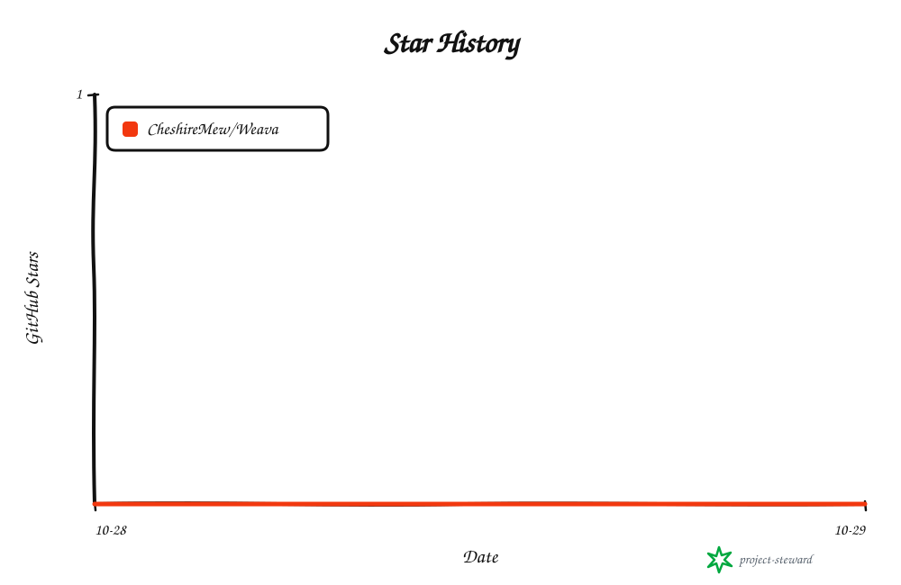

<!-- readme-header:start -->

<p align="center">
  
</p>

<h1 align="center">Weava</h1>

<p align="center">
  <strong>A self-hosted, content-first website framework for writing, publishing, and managing your site.</strong>
</p>

<p align="center">
  <a href="./README.md">中文</a> · <strong>English</strong> · <a href="./README.ja.md">日本語</a> | <a href="./docs/authoring.md">文档</a> | <a href="./CONTRIBUTING.md">贡献</a> | <a href="https://github.com/CheshireMew/Weava/issues">反馈</a>
</p>

<p align="center">
  <a href="https://x.com/0xCheshire" title="X"></a>
  <a href="https://t.me/CheshireBTC" title="Telegram"></a>
  <a href="https://blog.blacknico.com/" title="Blog"></a>
  <a href="https://blacknico.com/" title="Homepage"></a>
</p>

<p align="center">
  <a href="https://github.com/CheshireMew/Weava/stargazers"></a>
  <a href="https://github.com/CheshireMew/Weava/forks"></a>
  <a href="https://github.com/CheshireMew/Weava/blob/main/LICENSE"></a>
</p>

<!-- readme-header:end -->

Weava builds and manages blogs, company websites, portfolios, documentation sites, and resource directories. Write in the browser, upload media, preview, and publish; use the CLI or API for custom content structures and automation. Content and settings live in a separate site directory, so everyday updates do not require a rebuild.

Install each program version, admin interface, and dependency set once and share it across multiple sites. Each site keeps its own databases, account, media, settings, and program version selection. The steps below take you from installing a shared program to creating a site and publishing your first article.

## What you can do

| Your task | What Weava provides |
| --- | --- |
| Write articles and short notes | Visual and Markdown source editing, tables, task lists, and code blocks; a separate notes library and a timeline for reading notes |
| Save and publish | Autosave, browser draft recovery, multi-window conflict comparison, revision previews, scheduled publishing, and public release rollback |
| Manage media and the site | Drag-and-drop uploads, resumable transfers, media groups, and image cropping; about text, friend links, categories, tags, navigation, appearance, and advertisements |
| Engage readers | A Newsletter theme, article outlines, likes, comments and replies, a guestbook, owner replies, and moderation |
| Make content discoverable | Chinese-language search, search and sharing metadata, RSS, sitemaps, and redirects from old URLs |
| Understand traffic | Trends, sources, devices, regions, visitor journeys, live visitors, period comparisons, and CSV export |
| Create and customize sites | Blog, company, portfolio, documentation, resource, and blank starters; content structures through the CLI or API, and custom pages with Astro and React |
| Migrate and maintain | WordPress content, media, comments, and analytics migration; full backups, history archiving, multi-site management, and program upgrades with page and SEO comparisons |

Features are enabled per site. Blog and demo starters enable content, media, analytics, and engagement; company, portfolio, documentation, and resource starters enable the first three. Blank starters keep only account, settings, and maintenance. Notes also requires a note content type. See [Feature selection](docs/shared-runtime.md#功能选择与专用开发).

A single owner account manages each site. The admin focuses on everyday writing and site management; use the [CLI or API](docs/interfaces.md) to customize content structures and templates. Private content, media access controls, and optional two-factor authentication are also available. See [Authoring](docs/authoring.md) for usage details. The admin and linked documentation are currently in Chinese.

## Create a site

The currently validated platform is **Windows**. You need Git, **Node.js 24.12–24.x**, and **pnpm 12.4.2**. Programs are currently prepared from source. `setup.ps1` installs locked dependencies and the specified pnpm version if the dedicated copy is missing.

First, build and register a shared program in PowerShell:

```powershell
git clone https://github.com/CheshireMew/Weava.git
cd Weava
powershell -NoProfile -File .\scripts\setup.ps1
powershell -NoProfile -File .\scripts\run.ps1 build --output E:\WeavaRuntime\programs\weava-0.2.0
powershell -NoProfile -File .\scripts\install.ps1 -Program E:\WeavaRuntime\programs\weava-0.2.0 -Root E:\WeavaRuntime -SitesRoot E:\WeavaSites -BackupRoot E:\WeavaBackups
```

Node defaults to `D:\Tools\NodeJS\node.exe`; tools, caches, and dependency storage use drive D. For another Node location, set `$env:WEAVA_NODE='full path to node.exe'` and add `-Node $env:WEAVA_NODE` to the install command. You can change the program, site, and backup paths. Build into a new directory to preserve existing program versions.

After installation, use the same entry point to create a blog, start its background service, and generate an account setup link:

```powershell
E:\WeavaRuntime\weava.cmd site create my-site --template blog --theme newsletter --port 4322
E:\WeavaRuntime\weava.cmd --human site start my-site
E:\WeavaRuntime\weava.cmd --site my-site owner setup-link
```

`my-site` is the site ID; its data lives in `E:\WeavaSites\my-site`. The starter includes replaceable sample content. See [Shared programs and multiple sites](docs/shared-runtime.md) for other starters and custom paths. The service runs in the background and remains available after you close the terminal.

Now publish your first article:

1. Open the one-time setup link returned by the last command and choose an owner username and password. It expires after 10 minutes; run that command again to generate a new link.
2. Sign in to the [local admin](http://127.0.0.1:4322/admin/) with your new account. Create an article and enter its title and body.
3. Choose Preview (预览), then Publish (发布), review the changes, and confirm.
4. Open the [site homepage](http://127.0.0.1:4322/) to view your published article.

Articles autosave as drafts and go public after confirmation. Settings take effect after autosave. Blogs have a Notes (笔记) entry: write, publish directly, and read notes on the `/notes/` timeline. Visual and source editing share a Markdown body and accept multiple dropped images. See [Authoring](docs/authoring.md) for formatting and older content conversion.

The service listens locally by default. Public access requires a domain and reverse proxy configuration. See [Operations, backups, and recovery](docs/operations.md) for password resets, two-factor recovery, and automated initialization.

## Migrate an existing site

WordPress migration accepts standard WXR XML. Run a preflight check, then use the conversion report to import content, attachments, and comments. In the admin, Backups and maintenance (备份与维护) supports preflight and import while the site is running.

The CLI uses an offline migration entry point. Stop the target site first, even for `--dry-run`. This example stops the site, checks the WXR file without importing it, and starts the site again:

```powershell
E:\WeavaRuntime\weava.cmd site stop my-site
E:\WeavaRuntime\weava.cmd --site my-site migrate wxr --input E:\Exports\wordpress.xml --dry-run
E:\WeavaRuntime\weava.cmd --human site start my-site
```

Preflight reports changes without saving them. Review unsupported plugin blocks, dynamic blocks, and shortcodes in the editor before publishing. Old URLs, offline media, historical view counts, and WP Statistics data have dedicated migration paths. See [Migration](docs/migration.md) and [WP Statistics migration](docs/wordpress-statistics.md).

## Run the site and manage its data

Source, shared programs, and site data are stored separately. Each site has its own process and port. Its directory holds databases, articles, media, account configuration, analytics, and custom code. Use a complete instance backup to preserve the site. See [Operations](docs/operations.md).

Use the installed entry point to list, inspect, stop, and restart sites:

```powershell
E:\WeavaRuntime\weava.cmd site list
E:\WeavaRuntime\weava.cmd site inspect my-site
E:\WeavaRuntime\weava.cmd site stop my-site
E:\WeavaRuntime\weava.cmd --human site start my-site
```

You can also double-click the generated `start.bat` **inside the site directory**. The site keeps running when the prompt window closes. To monitor it in the terminal and stop it with Ctrl+C, use `site start my-site --foreground`. CLI commands return JSON by default for scripts and external tools; `--human` provides readable startup messages.

Create sites with different IDs and ports to share a program. Each pins its version. Before upgrading, run `site update my-site --to PROGRAM_ID --check` to rehearse migrations and compare anonymous pages, URLs, and SEO metadata. Unexpected differences block the switch. See [Shared programs](docs/shared-runtime.md) for upgrades, recovery, startup tasks, and proxies.

## Development

Astro serves visitor pages, React provides the admin, and the TypeScript core manages content, revisions, publication, search, and maintenance. SQLite stores site data. Ordinary visitor pages do not load the React admin or Lexical editor.

After installing dependencies, initialize a separate development site and start the development server from the repository root:

```powershell
powershell -NoProfile -File .\scripts\run.ps1 --site E:\WeavaSites\dev-site init --demo --port 4323
powershell -NoProfile -File .\scripts\run.ps1 --site E:\WeavaSites\dev-site dev
```

Keep the development terminal open and press Ctrl+C to stop. The source repository's `start.bat` also runs in the foreground. Use `--site` to select an initialized site; it defaults to `demo`. It serves a different purpose from the background launcher generated inside each site.

Framework changes need a new program build. Put custom Astro or React pages in the site's `custom` directory and activate a build with `site build SITE_ID --apply`. Editing and publishing use the existing program. See [Contributing](CONTRIBUTING.md) for checks, tests, and build commands, and [Shared programs](docs/shared-runtime.md) for custom pages and the SDK.

## Documentation

| Topic | Entry point |
| --- | --- |
| Writing, media, and publishing | [Authoring](docs/authoring.md) |
| Installation, multiple sites, and custom pages | [Shared programs and multiple sites](docs/shared-runtime.md) |
| Running, backups, recovery, and upgrades | [Operations](docs/operations.md) · [Accounts and site protection](docs/security.md) |
| Site and analytics migration | [Migration](docs/migration.md) · [WP Statistics](docs/wordpress-statistics.md) |
| Traffic analytics and geolocation | [Analytics](docs/analytics.md) |
| Customization and automation | [API and CLI](docs/interfaces.md) · [API reference](docs/api-reference.md) · [Themes and extensions](docs/extensions.md) |
| Architecture and maintenance records | [Architecture and data](docs/architecture.md) · [Implementation](docs/implementation.md) · [Completion and validation records](docs/completion-plan.md) |

## Star History

<picture>
  <source media="(prefers-color-scheme: dark)" srcset="https://raw.githubusercontent.com/CheshireMew/Weava/star-history/star-history-dark.svg">
  <source media="(prefers-color-scheme: light)" srcset="https://raw.githubusercontent.com/CheshireMew/Weava/star-history/star-history.svg">
  
</picture>

## License and third-party resources

The framework is licensed under **AGPL-3.0-only**. See [LICENSE](LICENSE) and [NOTICE](NOTICE). Site articles, source media, analytics, and private configuration are outside this repository's software distribution.

Third-party dependencies retain their own licenses; see the [dependency inventory](docs/dependencies.json). The admin analytics map uses [Natural Earth's public-domain country boundaries](https://www.naturalearthdata.com/about/terms-of-use/). Optional geolocation uses separately downloaded [DB-IP Lite](https://db-ip.com/db/lite.php) data with attribution under CC BY 4.0. Full source notices are in NOTICE.
