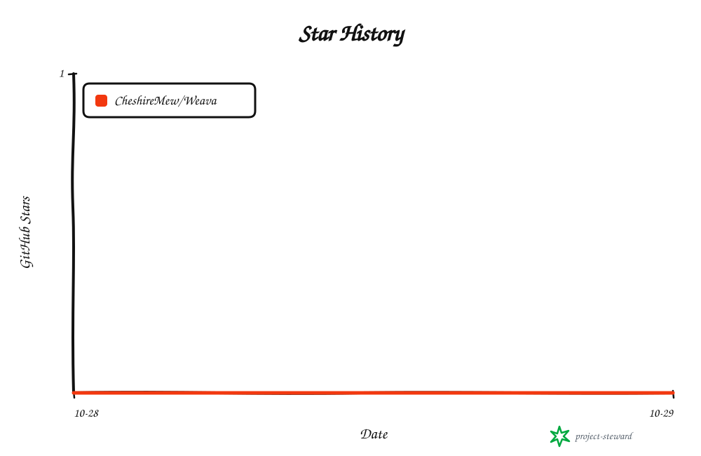

<!-- readme-header:start -->

<p align="center">
  
</p>

<h1 align="center">Weava</h1>

<p align="center">
  <strong>執筆・公開・サイト管理をまとめて行える、セルフホスト型のコンテンツ中心の Web サイトフレームワーク。</strong>
</p>

<p align="center">
  <a href="./README.md">中文</a> · <a href="./README.en.md">English</a> · <strong>日本語</strong> | <a href="./docs/authoring.md">文档</a> | <a href="./CONTRIBUTING.md">贡献</a> | <a href="https://github.com/CheshireMew/Weava/issues">反馈</a>
</p>

<p align="center">
  <a href="https://x.com/0xCheshire" title="X"></a>
  <a href="https://t.me/CheshireBTC" title="Telegram"></a>
  <a href="https://blog.blacknico.com/" title="Blog"></a>
  <a href="https://blacknico.com/" title="Homepage"></a>
</p>

<p align="center">
  <a href="https://github.com/CheshireMew/Weava/stargazers"></a>
  <a href="https://github.com/CheshireMew/Weava/forks"></a>
  <a href="https://github.com/CheshireMew/Weava/blob/main/LICENSE"></a>
</p>

<!-- readme-header:end -->

Weava は、ブログ、企業サイト、ポートフォリオ、ドキュメントサイト、リソース一覧を構築・管理するためのフレームワークです。ブラウザーの管理画面で執筆、メディアのアップロード、プレビュー、公開を行い、CLI／API でコンテンツ構造のカスタマイズや操作の自動化ができます。記事とサイト設定は独立したサイトディレクトリに保存され、日常の更新でプログラムを再ビルドする必要はありません。

同じバージョンのプログラム、管理画面、依存関係は一度だけインストールし、複数サイトで共有できます。各サイトのデータベース、アカウント、メディア、設定、使用バージョンは独立しています。以下では共通プログラムの導入から、サイト作成と最初の記事の公開までを説明します。

## できること

| やりたいこと | Weava の機能 |
| --- | --- |
| 記事と短いノートを書く | ビジュアル／Markdown ソース編集、表、タスクリスト、コードブロック。ノート専用の管理画面と閲覧用タイムライン |
| 保存と公開 | 自動保存、ブラウザー内の下書き復元、複数ウィンドウ間の競合比較、履歴プレビュー、予約公開、公開バージョンの切り戻し |
| メディアとサイトの管理 | ドラッグ＆ドロップ、アップロードの再開、メディアのグループ分け、画像の切り抜き。サイト紹介、相互リンク、カテゴリーとタグ、ナビゲーション、外観、広告 |
| 読者との交流 | Newsletter テーマ、記事の目次、いいね、コメントと返信、ゲストブック、運営者の返信、コメント管理 |
| コンテンツの発見 | 中国語検索、検索・共有用の情報、RSS、サイトマップ、旧 URL からのリダイレクト |
| アクセス分析 | 推移、流入元、端末、地域、訪問履歴、リアルタイムの訪問者、期間比較、CSV 出力 |
| サイト作成とカスタマイズ | ブログ、企業サイト、ポートフォリオ、ドキュメント、リソース一覧、空白のテンプレート。CLI／API によるコンテンツ構造の設定と Astro／React による専用ページ開発 |
| 移行と保守 | WordPress のコンテンツ、メディア、コメント、統計の移行。完全バックアップ、履歴アーカイブ、複数サイト管理、ページと SEO の差分を検査するプログラム更新 |

機能はサイトごとの設定で有効にします。ブログ・デモはコンテンツ、メディア、アクセス統計、読者との交流を、企業サイト・ポートフォリオ・ドキュメント・リソース一覧は最初の三つを既定で有効にします。空白テンプレートはアカウント、設定、保守のみです。「笔记」入口にはノート用コンテンツタイプも必要です。変更方法は[機能の選択](docs/shared-runtime.md#功能选择与专用开发)を参照してください。

各サイトは単一の運営者アカウントで管理します。管理画面は日常の執筆とサイト管理に集中し、コンテンツ構造やテンプレートの変更には [CLI／API](docs/interfaces.md) を使用します。非公開コンテンツ、メディアのアクセス制御、任意の二要素認証も利用できます。詳しくは[執筆ガイド](docs/authoring.md)を参照してください。管理画面とリンク先のドキュメントは現在中国語です。

## サイトを作成する

現在の検証対象は **Windows** です。Git、**Node.js 24.12–24.x**、**pnpm 12.4.2** が必要です。現在はソースからプログラムを準備します。`setup.ps1` はロック済みの依存関係をインストールし、専用の pnpm がない場合は指定バージョンを導入します。

まず PowerShell で共通プログラムをビルドし、登録します。

```powershell
git clone https://github.com/CheshireMew/Weava.git
cd Weava
powershell -NoProfile -File .\scripts\setup.ps1
powershell -NoProfile -File .\scripts\run.ps1 build --output E:\WeavaRuntime\programs\weava-0.2.0
powershell -NoProfile -File .\scripts\install.ps1 -Program E:\WeavaRuntime\programs\weava-0.2.0 -Root E:\WeavaRuntime -SitesRoot E:\WeavaSites -BackupRoot E:\WeavaBackups
```

既定の Node パスは `D:\Tools\NodeJS\node.exe` で、ツール、ダウンロードキャッシュ、依存関係のストアも D ドライブを使用します。Node が別の場所にある場合は、先に `$env:WEAVA_NODE='node.exe のフルパス'` を設定し、インストールコマンドに `-Node $env:WEAVA_NODE` を追加してください。プログラム、サイト、バックアップの保存先は変更できます。ビルド先には新しいディレクトリを指定し、既存のプログラムバージョンを上書きしないでください。

導入後は同じ入口からブログを作成し、バックグラウンドサービスを起動して、アカウント設定リンクを発行します。

```powershell
E:\WeavaRuntime\weava.cmd site create my-site --template blog --theme newsletter --port 4322
E:\WeavaRuntime\weava.cmd --human site start my-site
E:\WeavaRuntime\weava.cmd --site my-site owner setup-link
```

`my-site` はサイト ID で、データは `E:\WeavaSites\my-site` に保存されます。テンプレートには差し替え可能なサンプルが含まれます。他のテンプレートと保存先の指定は[共通プログラムと複数サイト](docs/shared-runtime.md)を参照してください。サービスはバックグラウンドで動き、ターミナルを閉じても利用できます。

続けて最初の記事を公開します。

1. 最後のコマンドが返した一度限りの設定リンクを開き、運営者のユーザー名とパスワードを入力します。有効期限は 10 分です。期限切れの場合は同じコマンドで再発行します。
2. 新しいアカウントで[ローカル管理画面](http://127.0.0.1:4322/admin/)にログインし、記事を作成してタイトルと本文を入力します。
3. 「预览」で確認し、「发布」をクリックして変更内容を確認・承認します。
4. [サイトのトップページ](http://127.0.0.1:4322/)で公開された記事を確認します。

記事は下書きとして自動保存され、公開の確認後に閲覧者向けの内容が更新されます。サイト設定は自動保存後に反映されます。ブログには独立した「笔记」入口もあり、本文を書いて直接公開し、`/notes/` のタイムラインで読めます。ビジュアル編集とソース編集は同じ Markdown 本文を使い、複数画像のドロップにも対応します。書式と旧コンテンツの変換範囲は[執筆ガイド](docs/authoring.md)を参照してください。

既定のサービスはローカル接続のみを受け付けます。インターネットへの公開にはドメインとリバースプロキシの設定が必要です。パスワードの再設定、二要素認証の復旧、自動初期化については[運用・バックアップ・復旧](docs/operations.md)を参照してください。

## 既存サイトから移行する

WordPress の標準 WXR XML に対応しています。まず事前チェックを行い、変換レポートを確認してからコンテンツ、添付ファイル、コメントを取り込みます。管理画面の「备份与维护」では、サイトの稼働中に事前チェックとインポートができます。

CLI はオフライン移行用の入口です。`--dry-run` でも対象サイトを先に停止する必要があります。以下ではサイトを停止し、WXR ファイルの事前チェックだけを行ってから、サイトを再起動します。

```powershell
E:\WeavaRuntime\weava.cmd site stop my-site
E:\WeavaRuntime\weava.cmd --site my-site migrate wxr --input E:\Exports\wordpress.xml --dry-run
E:\WeavaRuntime\weava.cmd --human site start my-site
```

事前チェックは報告のみで保存しません。未対応のプラグインブロック、動的ブロック、ショートコードは、公開前に編集画面で確認してください。旧 URL、オフラインのメディア、過去の閲覧数、WP Statistics データにはそれぞれ移行手順があります。[旧サイトの移行](docs/migration.md)と [WP Statistics の移行](docs/wordpress-statistics.md)を参照してください。

## 運用とデータ

ソース、共通プログラム、サイトデータは別々に保存します。各サイトは独立したプロセスとポートを使い、サイトディレクトリにはデータベース、記事、メディア、アカウント設定、統計、専用コードが入ります。サイトの保全にはインスタンス全体のバックアップを使用してください。手順は[運用ガイド](docs/operations.md)にあります。

日常の一覧表示、状態確認、停止、再起動にはインストール先の入口を使います。

```powershell
E:\WeavaRuntime\weava.cmd site list
E:\WeavaRuntime\weava.cmd site inspect my-site
E:\WeavaRuntime\weava.cmd site stop my-site
E:\WeavaRuntime\weava.cmd --human site start my-site
```

**サイトディレクトリ内**に生成された `start.bat` をダブルクリックすることもできます。案内ウィンドウを閉じてもサイトは動き続けます。ターミナルで監視し、Ctrl+C で停止したい場合は `site start my-site --foreground` を使います。CLI はスクリプトや外部ツール向けに既定で JSON を返し、`--human` は読みやすい起動案内を表示します。

別の ID とポートで二つ目のサイトを作れば、導入済みプログラムを共有できます。各サイトは選択したバージョンを固定し、新しいプログラムの追加だけでは更新されません。更新前に `site update my-site --to PROGRAM_ID --check` を実行すると、移行を試行し、匿名ページ、URL、SEO 情報を比較できます。予期しない差分は切り替えを止めます。登録、正式な更新、復旧、自動起動、リバースプロキシは[共通プログラムと複数サイト](docs/shared-runtime.md)を参照してください。

## 開発

Astro が閲覧者向けページ、React が管理画面を提供し、TypeScript コアがコンテンツ、履歴、公開、検索、保守を担います。サイトデータは SQLite に保存します。通常の公開ページは React 管理画面や Lexical エディターを読み込みません。

依存関係のインストール後、リポジトリのルートで独立した開発用サイトを初期化し、開発サーバーを起動します。

```powershell
powershell -NoProfile -File .\scripts\run.ps1 --site E:\WeavaSites\dev-site init --demo --port 4323
powershell -NoProfile -File .\scripts\run.ps1 --site E:\WeavaSites\dev-site dev
```

開発用ターミナルは開いたままにし、Ctrl+C で停止します。ソースリポジトリの `start.bat` もフォアグラウンドで動きます。`--site` で初期化済みのサイトを指定し、省略時は `demo` を選択します。各サイトに生成されるバックグラウンド用の起動スクリプトとは用途が異なります。

フレームワークのコード変更にはプログラムの再ビルドが必要です。サイト専用の Astro／React ページはサイトの `custom` ディレクトリに置き、`site build SITE_ID --apply` でビルドして有効にします。日常の編集と公開では既存プログラムを使います。開発チェック、対象テスト、ビルドコマンドは[コントリビューションガイド](CONTRIBUTING.md)、専用ページと SDK は[共通プログラムの文書](docs/shared-runtime.md)を参照してください。

## ドキュメント

| 内容 | 入口 |
| --- | --- |
| 執筆、メディア、公開 | [執筆ガイド](docs/authoring.md) |
| インストール、複数サイト、専用ページ | [共通プログラムと複数サイト](docs/shared-runtime.md) |
| 運用、バックアップ、復旧、更新 | [運用](docs/operations.md) · [アカウントとサイト保護](docs/security.md) |
| サイトと統計の移行 | [移行](docs/migration.md) · [WP Statistics](docs/wordpress-statistics.md) |
| アクセス統計と地域データ | [アクセス分析](docs/analytics.md) |
| カスタマイズと自動化 | [API と CLI](docs/interfaces.md) · [API リファレンス](docs/api-reference.md) · [テーマと拡張機能](docs/extensions.md) |
| 設計と保守記録 | [アーキテクチャとデータ](docs/architecture.md) · [実装記録](docs/implementation.md) · [整備計画と検証記録](docs/completion-plan.md) |

## Star History

<picture>
  <source media="(prefers-color-scheme: dark)" srcset="https://raw.githubusercontent.com/CheshireMew/Weava/star-history/star-history-dark.svg">
  <source media="(prefers-color-scheme: light)" srcset="https://raw.githubusercontent.com/CheshireMew/Weava/star-history/star-history.svg">
  
</picture>

## ライセンスと第三者リソース

フレームワークは **AGPL-3.0-only** で提供します。[LICENSE](LICENSE) と [NOTICE](NOTICE) を参照してください。サイトの記事、元のメディア、アクセス統計、非公開設定は、このリポジトリのソフトウェア配布範囲に含まれません。

第三者の依存パッケージには各自のライセンスが適用されます。[依存関係の一覧](docs/dependencies.json)を参照してください。管理画面の統計地図は [Natural Earth のパブリックドメイン国境データ](https://www.naturalearthdata.com/about/terms-of-use/)に基づきます。任意の地域判定では、別途ダウンロードする [DB-IP Lite](https://db-ip.com/db/lite.php) のデータを CC BY 4.0 の帰属表示付きで使用します。出典の詳細は NOTICE にあります。
