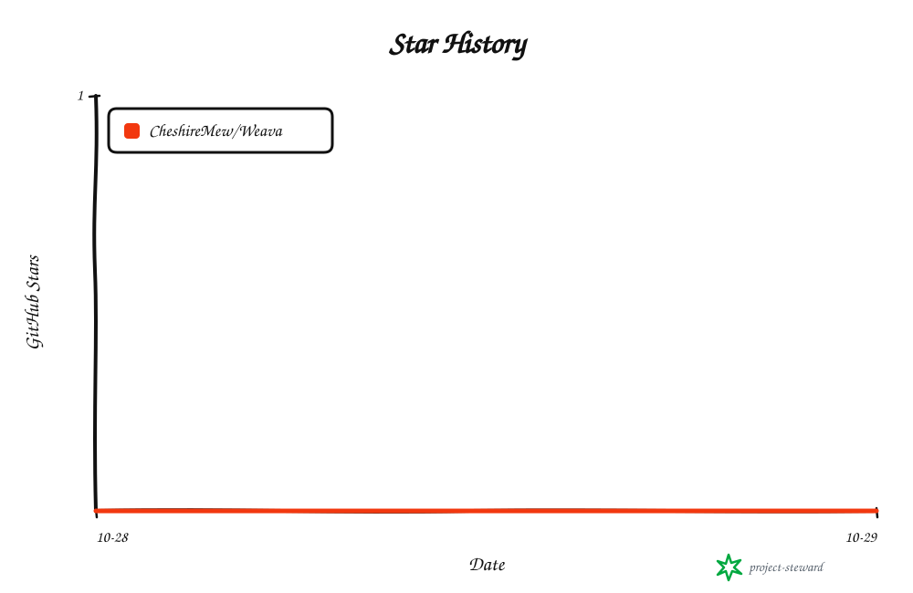

<!-- readme-header:start -->

<p align="center">
  
</p>

<h1 align="center">Weava</h1>

<p align="center">
  <strong>以内容为中心的自托管建站框架，集中完成写作、发布与网站管理。</strong>
</p>

<p align="center">
  <strong>中文</strong> · <a href="./README.en.md">English</a> · <a href="./README.ja.md">日本語</a> | <a href="./docs/authoring.md">文档</a> | <a href="./CONTRIBUTING.md">贡献</a> | <a href="https://github.com/CheshireMew/Weava/issues">反馈</a>
</p>

<p align="center">
  <a href="https://x.com/0xCheshire" title="X"></a>
  <a href="https://t.me/CheshireBTC" title="Telegram"></a>
  <a href="https://blog.blacknico.com/" title="Blog"></a>
  <a href="https://blacknico.com/" title="Homepage"></a>
</p>

<p align="center">
  <a href="https://github.com/CheshireMew/Weava/stargazers"></a>
  <a href="https://github.com/CheshireMew/Weava/forks"></a>
  <a href="https://github.com/CheshireMew/Weava/blob/main/LICENSE"></a>
</p>

<!-- readme-header:end -->

Weava 用来构建和管理博客、官网、作品集、文档站与资源目录。你可以在浏览器后台写作、上传媒体、预览并发布内容，也可以通过 CLI／API 定制内容结构和自动化操作。文章和网站设置保存在独立的站点目录中，日常更新无需重新构建程序。

0.2 增加共用程序安装和多站点管理：同一版本的程序、后台和依赖安装一次，各网站独立保存资料并明确选择版本。正式使用从[共用程序与多个网站](docs/shared-runtime.md)开始；该文档说明创建模板网站、后台托管、专用页面开发和原位接管。下方源码入口继续用于开发和初次准备程序。

## 可以做什么

| 你要做的事 | Weava 提供的能力 |
| --- | --- |
| 写作与发布 | 可视化或 Markdown 编辑、表格与媒体、自动保存、历史对比、冲突恢复、预览、定时发布与公开版本回退 |
| 管理网站 | 关于本站、友情链接、分类标签、导航、外观和广告；内容类型、自定义字段、模板与扩展可通过 CLI／API 定制 |
| 与读者互动 | Newsletter 主题、文章目录、点赞、评论与回复、站主回复和后台审核 |
| 帮助内容被找到 | 中文搜索、搜索与分享信息、RSS、站点地图和旧网址跳转 |
| 了解访问情况 | 趋势、来源、设备、地区、访客轨迹、实时在线、同期对比与 CSV 导出 |
| 迁移与维护 | WordPress 导入、媒体和评论迁移、目录备份与恢复、历史归档和独立程序版本升级 |

网站由单个站主账户管理。后台聚焦日常写作与网站管理，内容结构和模板定制通过 [CLI／API](docs/interfaces.md) 完成。私密内容、媒体访问控制和可选两步验证也已提供；具体用法见[使用与编辑](docs/authoring.md)。

## 新建站点

当前验收平台为 **Windows**，需要 **Node.js 24.12–24.x** 和 **pnpm 12.4.2**。以下命令从源码安装，创建一个带示例内容的站点，再构建并启动程序：

```powershell
git clone https://github.com/CheshireMew/Weava.git
cd Weava
powershell -NoProfile -File .\scripts\setup.ps1
powershell -NoProfile -File .\scripts\run.ps1 --site E:\WeavaSites\my-site init --demo --port 4322
powershell -NoProfile -File .\scripts\run.ps1 build
powershell -NoProfile -File .\scripts\run.ps1 --site E:\WeavaSites\my-site start
```

`setup.ps1` 安装锁定依赖，并在缺少专用 pnpm 时安装指定版本。脚本默认使用 `D:\Tools\NodeJS\node.exe`，工具、下载缓存与依赖存储也使用 D 盘。Node 安装在其他位置时，先设置 `$env:WEAVA_NODE='你的 node.exe 完整路径'`。`E:\WeavaSites\my-site` 是示例数据目录，可以替换为自己的位置。

启动后保持终端窗口打开，按以下步骤完成第一次发布：

1. 打开终端显示的一次性设置链接，在网页中填写站主账户名和密码。链接有效期为 10 分钟。
2. 使用新账户登录[本地后台](http://127.0.0.1:4322/admin/)，新建一篇文章，填写标题和正文。
3. 点击“预览”检查效果，再点击“发布”，查看变更并确认。
4. 打开[网站首页](http://127.0.0.1:4322/)，查看已发布的文章。

文章自动保存为草稿，确认发布后才更新访客看到的内容；网站设置自动保存后直接生效。服务默认只监听本机，初始化与启动不会自动把网站发布到互联网。

设置链接过期时，针对同一站点重新生成：

```powershell
powershell -NoProfile -File .\scripts\run.ps1 --site E:\WeavaSites\my-site owner setup-link
```

忘记密码、两步验证恢复和自动化初始化见[运行、备份与恢复](docs/operations.md)。

## 迁移已有网站

WordPress 迁移支持标准 WXR XML，先预检，再根据转换报告导入内容、附件与评论。可在后台“备份与维护”选择文件，也可以通过 CLI 预检：

```powershell
powershell -NoProfile -File .\scripts\run.ps1 --site E:\WeavaSites\my-site migrate wxr --input E:\Exports\wordpress.xml --dry-run
```

预检只报告，不保存。未知插件区块、动态区块和短代码需要在编辑页核查后再发布。旧网址、离线媒体、历史浏览量及 WP Statistics 数据各有迁移入口，见[旧站迁移](docs/migration.md)和 [WP Statistics 迁移](docs/wordpress-statistics.md)。

## 运行与数据

框架源码与站点数据分开保存。仓库包含程序、文档和测试；站点目录保存数据库、文章、媒体、账户配置、统计和迁移资料。备份应使用完整实例备份，操作方法见[运行文档](docs/operations.md)。

完成初始化和构建后，可用下面的入口再次启动同一个站点。双击 `start.bat` 则启动默认的 `../WeavaSites/demo`，该默认站点也需要事先初始化。

```powershell
.\start.bat --site "E:\WeavaSites\my-site"
```

窗口保持打开，按 Ctrl+C 停止；同一个站点只运行一份服务。更换端口可加 `--port 4323`。源码或主题、扩展代码变化需要重新构建；日常编辑和发布内容沿用现有程序。服务器运行与反向代理配置见运行文档，当前平台验证范围仍为 Windows。

## 开发

Astro 提供访客页面，React 提供管理后台，TypeScript 核心负责内容、修订、发布、搜索与维护，SQLite 保存站点数据。普通访客页面不加载 React 管理后台或 Lexical 编辑器。

在完成依赖安装的仓库根目录运行：

```powershell
pnpm check
pnpm test
pnpm build
pnpm weava --site E:\WeavaSites\my-site dev
```

程序构建与内容发布分开进行。开发约定、按改动选择验证及浏览器检查入口见[贡献指南](CONTRIBUTING.md)。

## 文档

| 要了解的内容 | 入口 |
| --- | --- |
| 写作、媒体与发布 | [使用与编辑](docs/authoring.md) |
| 运行、备份、恢复与升级 | [运行文档](docs/operations.md) · [账户与网站防护](docs/security.md) |
| 迁移旧站与统计 | [旧站迁移](docs/migration.md) · [WP Statistics](docs/wordpress-statistics.md) |
| 访问统计与地区库 | [访问统计](docs/analytics.md) |
| 定制与自动化 | [API 与 CLI](docs/interfaces.md) · [API 参考](docs/api-reference.md) · [主题与扩展](docs/extensions.md) |
| 架构与维护记录 | [架构与数据](docs/architecture.md) · [实施记录](docs/implementation.md) · [完善计划与验证记录](docs/completion-plan.md) |

## Star History

<picture>
  <source media="(prefers-color-scheme: dark)" srcset="https://raw.githubusercontent.com/CheshireMew/Weava/star-history/star-history-dark.svg">
  <source media="(prefers-color-scheme: light)" srcset="https://raw.githubusercontent.com/CheshireMew/Weava/star-history/star-history.svg">
  
</picture>

## 许可证与第三方资源

框架采用 **AGPL-3.0-only**，见 [LICENSE](LICENSE) 和 [NOTICE](NOTICE)。站点文章、来源媒体、统计和私有配置不属于本仓库的软件分发范围。

第三方依赖保留各自许可，见[依赖声明](docs/dependencies.json)。统计世界地图基于 [Natural Earth 公共领域国界数据](https://www.naturalearthdata.com/about/terms-of-use/)，用于后台地图；可选地区查询使用单独下载的 [DB-IP Lite](https://db-ip.com/db/lite.php) 数据，按 CC BY 4.0 保留署名。完整来源说明见 NOTICE。
